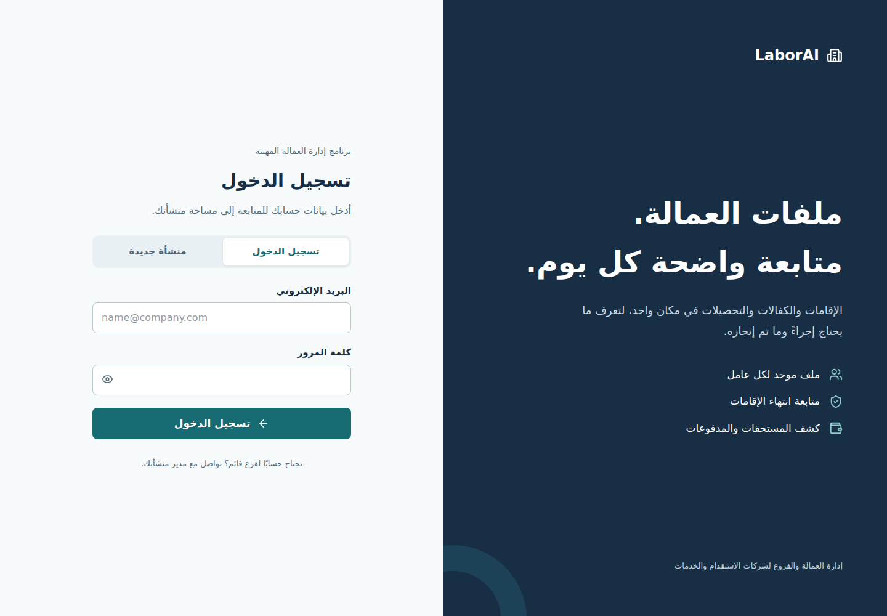
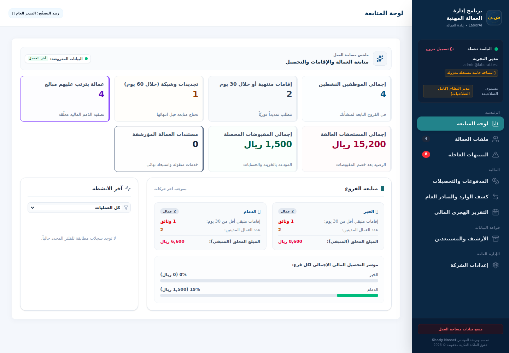
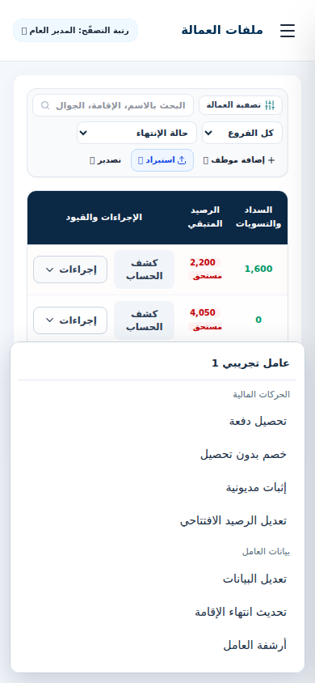
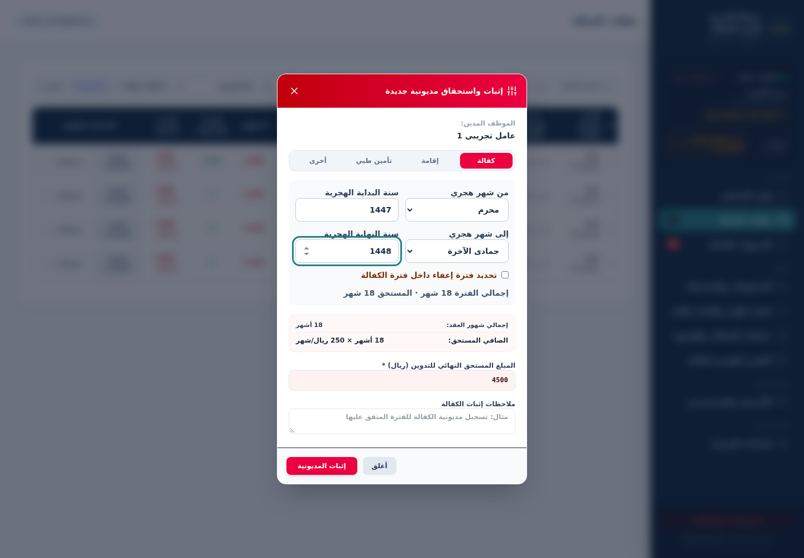
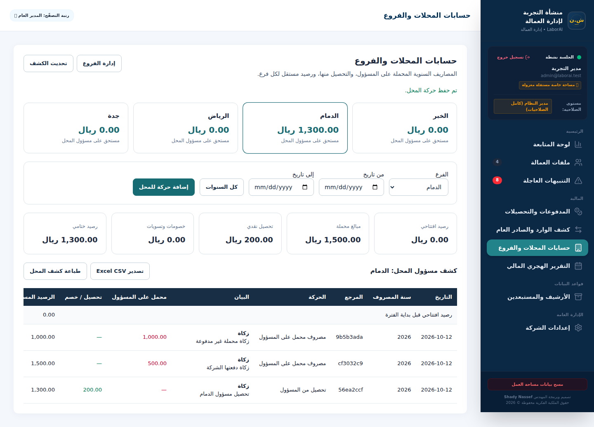
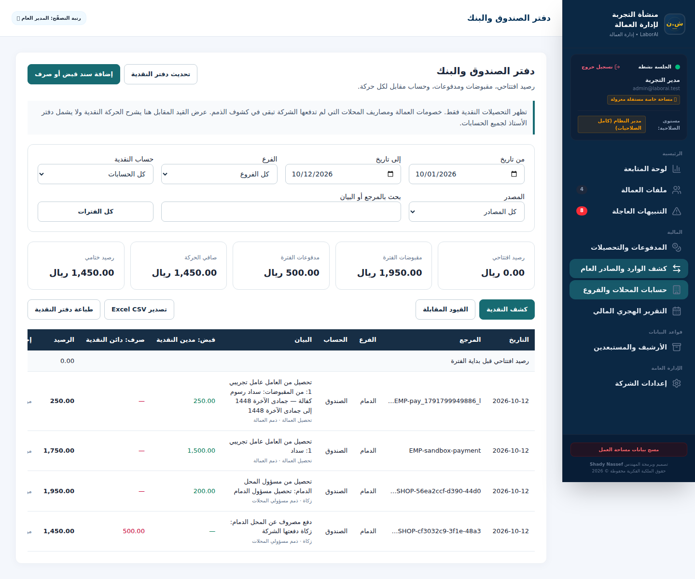
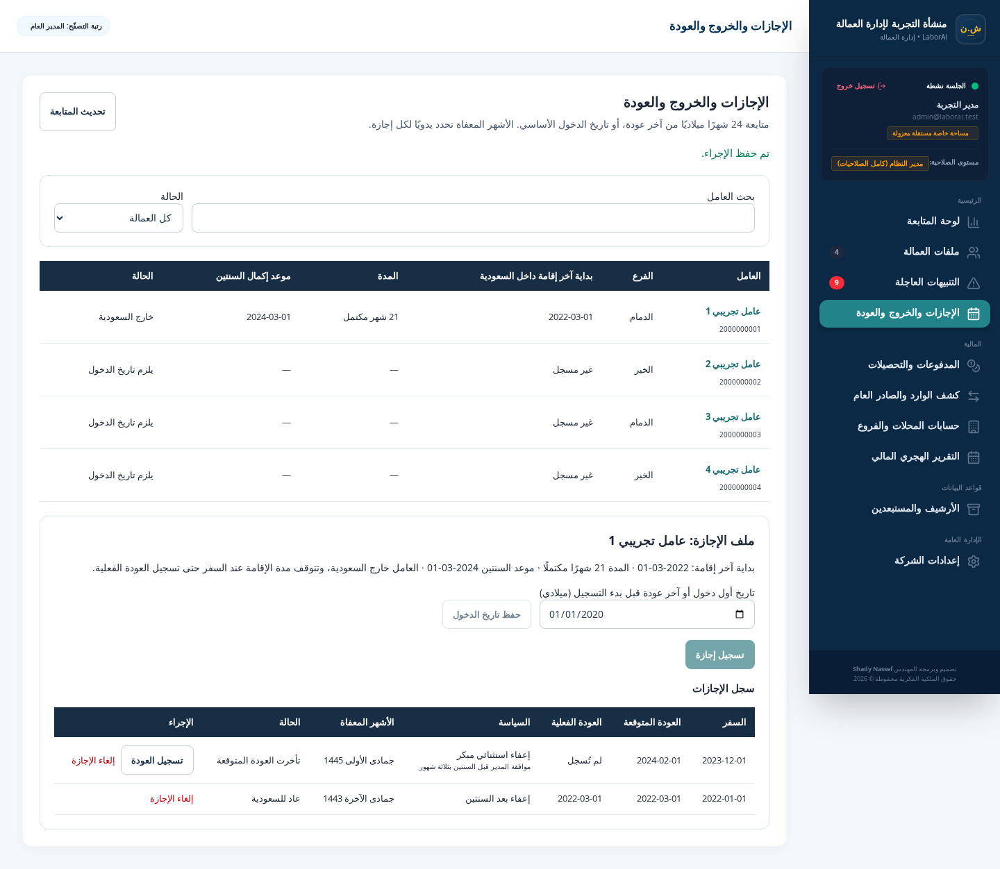

# LaborAI review and deployment

## Implemented

- User creation is insert-only with server-generated IDs; public registration cannot update an existing account or choose tenant/status. New passwords are always hashed on the server.
- User management requires an authenticated company administrator. Authentication reads the current account on every request; deletion, rejection, role or tenant changes invalidate existing tokens.
- Employees, payments and ledger records use `(tenant_id, record_id)` primary keys. A transactional migration preserves existing rows, normalizes NULL tenants to the default space, and replaces the previous primary keys.
- Branch accounts read and write only their assigned branch. Payment names/branches come from the employee record, and payments must refer to an employee in the same company. Ledger writes are administrator-only; other users may read the company ledger when its administrator allows it.
- Payment deletion is persisted. Employee/payment deletion and space creation use transactions. Default-space reset affects only that space.
- Expired subscriptions are enforced on the API. Production refuses to start without PostgreSQL and never accepts temporary in-memory writes. In-memory fallback requires an explicit non-production opt-in.
- Print documents escape names, descriptions and notes. Uploaded print logos accept only raster data URLs. Employee balances match by iqama number, never by name.
- Arabic login redesign, clearer dashboard metrics, expired iqama counts, responsive spacing, labelled login controls, keyboard focus and reduced-motion support. Developer UI uses a server-returned capability instead of a hardcoded email.
- Excel parsing is loaded only on import. SheetJS uses the official 0.20.3 tarball. Unused Gemini/MySQL/motion dependencies were removed and compatible dependency patches applied.
- Automated security tests, GitHub CI, local-only disposable sandbox, non-root Docker app, loopback ports, database readiness and app health checks.

## Validation

`npm run check` runs TypeScript, production build and the integration/print tests. The integration test uses a disposable PGlite PostgreSQL engine through the same `pg` wire client used in production; it verifies legacy schema migration and preservation, tenant collisions, role escalation, branch boundaries, subscription expiry, payment persistence and session revocation. It is not a substitute for a staging smoke test on your deployed PostgreSQL version.

`npm audit` was clear after dependency patches and the SheetJS update. This is a registry advisory check, not a guarantee that no vulnerabilities exist.

Browser smoke checks covered login, registration, navigation, employee files and settings at desktop/mobile sizes. Chromium screenshots were visually reviewed; there were no JavaScript errors or unwanted horizontal overflow on the dashboard. Docker configuration was inspected, but a Docker engine was not available to build or run the image here.

## Before production deployment

1. Back up the current PostgreSQL database and verify that the backup can be restored. The migration changes keys and creates a normalized-email unique index; duplicate emails that differ only by case/whitespace must be resolved first. Unknown custom foreign keys may block the migration; initialization then fails rather than serving requests on an inconsistent schema.
2. Test on a separate PostgreSQL instance. Keep `ALLOW_DESTRUCTIVE_SCHEMA_MIGRATION=false`. No production database was accessed during this review.
3. Configure `.env` using `.env.example`; retain the current `DEV_EMAIL`, `JWT_SECRET` and database identifiers unless intentionally rotating them. The example contains no real credentials.
4. Ports 3150, 5432 and 8085 now bind to `127.0.0.1`. A same-host reverse proxy or tunnel can reach them; remote direct access needs an explicit binding change or SSH tunnel.
5. pgAdmin is optional: `docker compose --profile tools up -d pgadmin`; set `PGADMIN_DEFAULT_PASSWORD` first.
6. Update and rebuild with `docker compose up -d --build`. Check `docker compose ps`, application logs and `/api/health` through the configured site. Existing data volumes are preserved.

## Published backup still needs remediation

`backup_20260706.sql` was removed from the branch and backup files are ignored/excluded from Docker builds. It contained workforce/payment data and password hashes in a public repository. This change does **not** erase the existing Git history or already downloaded copies. Repository history cleanup and credential rotation are separate operations that have not been performed. Restrict repository visibility if appropriate and rotate affected credentials; review whether other real data was published.

## Disposable local development

```bash
npm ci
npm run sandbox
```

The sandbox runs at `http://127.0.0.1:3151`, uses disposable PGlite storage, binds locally, and never connects to the production database. Login is `admin@laborai.test` / `Sandbox-only-2026`; these credentials exist only in the sandbox. All records disappear when it exits. `SANDBOX_PORT` changes its port.

## Skills applied

- Sentry security-review: traced input and authorization paths and verified concrete attacks.
- Anthropic frontend-design: product-specific Arabic interface direction and visual review.
- Vercel web-design-guidelines: focus, labels, reduced motion and responsive checks.
- Anthropic webapp-testing: Playwright reconnaissance and browser smoke workflow.

Skills are development instructions; they are not dependencies bundled into LaborAI.

## UI smoke test

With the disposable sandbox running, install Python Playwright once (`python -m pip install playwright` and `python -m playwright install chromium`), then run `python tests/browser_smoke.py`. Screenshots go to the ignored `test-results/browser` directory.

## Interface previews





## Non-cash discounts and employee actions

Employee transactions now have a stored `transaction_kind`: receipt, debt, discount or settlement. The new nullable database column preserves existing records; legacy descriptions containing خصم or تسوية are classified as non-cash on read. Only receipts enter the automatic cash ledger, collection history and monthly collection reports. Discounts and settlements continue reducing the employee balance and appearing as credits in the employee statement. Debt entries are never treated as cash received. Explicit kinds survive later description edits.

The workforce table keeps a statement button and one grouped actions menu. The menu supports keyboard navigation, closes on Escape/outside click, and renders outside the horizontally scrolling table so it works on mobile. Discounts have a separate form that explains their accounting effect and waits for successful persistence before closing. Receipt submission rejects zero amounts, disables repeat submission while saving, and keeps the form open on a save failure. Employee codes are edited through the data form rather than sending an API update for every typed character.

Validation now includes 16 automated tests and a browser scenario: opening dues 3,800, receipt 1,500, discount 100 → employee outstanding 2,200; cash receipts remain 1,500 and the discount is absent from the cash ledger.



## Multi-year kafala and shop accounting

Kafala debt and receipt forms store both Hijri endpoint years and months. Month counts are inclusive across year boundaries; exemptions also have endpoint years and must fit within the debt period. Opening the debt dialog recalculates its displayed amount. The receipt suggestion observes the existing Ramadan pricing exemption and remains editable to match money actually received. The latest covered collection month/year comes only from kafala receipts, never debt, discount or settlement entries, and survives reload.

New worker debts persist as one entry with `balance_included=false`; worker totals include these entries once. Existing debt records with no marker retain their historical treatment as already included in employee balance fields. No old balances are rewritten. Worker statements re-read the current employee state. New nullable payment metadata preserves older records.

The new shop tab uses the company's existing, expandable branch list. Each shop has a separate account: annual charges and opening dues are debits; collections and non-cash waivers are credits. A date filter carries previous years into the opening balance. Unpaid charges create no cash movement. Selecting “company actually paid” produces one outgoing cash/bank movement; collecting from the responsible person produces one incoming movement. Document references are unique within a company's branch. Retries with the same ID are idempotent; conflicting retries are rejected. Branch accounts only read their assigned shop; viewers need ledger permission; only administrators post or delete shop entries. Branches with workforce or financial records cannot be removed.

The incoming/outgoing tab is now a cash/bank book with opening and closing balances, receipts, payments, running balance, branch/account/source/date filters, document references and counterpart accounts. A journal view shows balanced cash/counterpart lines. Printing and CSV export follow the selected view. This is a cashbook with counterpart presentation, not a complete general ledger, accrual system or statutory financial statement generator. Existing records whose cash/bank account was never recorded remain explicitly “unclassified cash”.

Startup adds the payment/ledger metadata and `shop_entries` table without deleting historical data. `schema.sql` reflects the new schema. Test the additive migration on a backed-up staging database before deployment.

Validation: `npm run check` passes 25 tests, including multi-year periods, bounded exemptions, legacy/new debt totals, shop carryforward, real cash projection, balanced journal, tenant/branch isolation, idempotent saves and protected branch removal. Browser validation is reproducible with `python tests/accounting_browser.py` against the disposable sandbox; it covers a 1447–1448 debt, receipt coverage after reload, four branches, paid/unpaid charges, collections and mobile accounting layout.







## Cashbook reconciliation and guarded workspace reset

The cashbook now shows a collapsible reconciliation by employee receipts, manual vouchers and shop cash movements. Totals include carryforward and observe the selected filters. Integer halalas keep running balances and source totals consistent. Negative cash balances are retained for reconciliation; they are not silently clamped to zero or “balanced” with invented entries. A cashbook closing balance differs from the debit/credit difference in the journal view. Production data remains unchanged.

PostgreSQL `DATE` values are read as calendar strings, preserving their stored date in Asia/Riyadh and other server timezones. This fixes one-day shifts and identical shop retries that were rejected when the server timezone was ahead of UTC. The integration suite explicitly uses Asia/Riyadh.

Workspace reset is available only in Settings. The duplicate sidebar reset path and its implicit company/pricing resets were removed. An administrator must enter their current password, type the exact confirmation phrase and acknowledge a restorable backup. The API checks all fields, the target tenant and bcrypt password, limits attempts per account and records the reset audit entry in the same database transaction. Users and company/pricing settings are preserved; workers, payments, cashbook, shop movements and branch records are cleared only in the authorized workspace. The browser acknowledgment does not independently verify the existence or restorability of a database backup.

Validation: 29 automated tests passed, including non-admin rejection, invalid confirmation/password/backup rejection, tenant isolation and transactional reset audit. `tests/wipe_browser.py` passed against disposable sandbox data, including disabled submission until all confirmations, wrong-password data preservation, successful reset and preserved company settings. No production reset was performed.


Manual ledger entries can explicitly store `cash_effect=noncash`. These remain intact and inspectable in a separate non-cash table, but are excluded from cash receipts/payments and the cash counterpart journal. Null legacy flags retain historical cash treatment until reviewed; descriptions alone do not silently reclassify a voucher. Old clients cannot accidentally overwrite an established non-cash flag by omitting the field. Confirmed legacy worker collections may be marked `transaction_kind=receipt` without rewriting their description or employee-credit amount. Legacy reclassification requires source review and a scoped, backed-up correction; startup does not automatically modify a company's historical cash classifications.

## Latest calculated kafala month

The worker statement and print view show the latest calculated kafala month separately from the latest explicitly covered collection month. The calculated date uses the debt period endpoint. Legacy records are supported only when their description/notes contain an explicit end month and year, including Arabic year digits and the common alias ربيع ثاني. Start-month metadata is never guessed to be the endpoint. Generic balance settlements do not imply kafala collection coverage. Both labels recalculate from existing worker transactions, so removing a debt restores the previous latest endpoint. Validation: 30 automated tests and the desktop/mobile accounting browser flow passed. No balances or historical payment metadata are rewritten.

For legacy records, a statement description edited locally is also read when deriving the display endpoint. This remains a browser-local statement annotation and does not rewrite the stored period or financial amounts. Structured debt periods take precedence over edited descriptions.

## Full-balance collections entered under Other

A general cash receipt now updates the last covered kafala month when cumulative actual collections cover all assessed worker dues, including opening obligations and other debt categories. Coverage is evaluated by transaction date and retained if a later assessment remains unpaid. Legacy debts already included in employee balance fields are not counted twice. Non-cash discounts and settlements do not contribute to cash coverage, and partial unallocated receipts do not invent a fully paid kafala period. Existing explicitly covered kafala receipts retain their treatment. Results are derived without changing historical records or cashbook amounts.

Legacy explicit period endpoints written with two-digit Hijri years are supported only when the payment has a valid full Hijri year establishing the century. Start metadata alone remains insufficient. The Other payment form includes a full-outstanding shortcut and clear amount/type labels; the submitted transaction is still an ordinary receipt.

Validation: `npm run check` passed 32 tests. `tests/full_balance_kafala_browser.py` passed against disposable data: legacy mixed-category dues, a full general receipt from Other, and the covered endpoint immediately and after reload. Unit cases also cover partial receipts, non-cash clearing, missing period years, unrelated workers, advance collections and subsequent unpaid assessments.

## Worker travel, two-year eligibility and manual kafala exemptions

A new Arabic travel/leave tab tracks calendar months inside Saudi Arabia, the two-year due date, planned travel, actual return and overdue expected returns. The baseline is an administrator-entered initial arrival or last return before tracking begins; missing dates are never inferred from worker creation or kafala start fields. Two years means 24 Hijri calendar months in Umm al-Qura, clamping day 30 to day 29 when necessary. All travel date entry, duration and due-date displays use Hijri. ISO storage continues to identify the same absolute days; existing leave approvals and financial snapshots are preserved. Time inside Saudi Arabia stops at departure until an actual return is recorded; expected return alone never resets the cycle. Actual return starts a new cycle. Alerts list eligible workers and those due within 90 days, and flag missing actual returns. Archived workers with travel history retain their record view.

Only administrators set the baseline, approve travel, grant early exceptions, record actual return or cancel a record. Branch users can read only travel for their assigned workers; tenant ownership is enforced for every operation. Early exemption requires an explicit exception policy and reason. Standard eligibility is checked at departure, including future planned departure dates. Normal-charge leave cannot contain exempt months. The administrator chooses individual Hijri months overlapping the recorded travel dates; partial travel months are never automatically waived. Only one unreturned planned/active trip is allowed. History is chronological; established baseline/actual-return dates are not silently overwritten. Cancellation requires a reason and excludes that record from eligibility calculations.

The debt form and kafala receipt suggestion use approved leave months. Overlapping leave/manual exemption months are counted once. The API derives approved months itself for new kafala periods and rejects new debt above the regular monthly rate times the chargeable month count. A fully exempt period requires no debt entry. The applied month list is saved with the payment, so later cancellation or return changes do not silently reprice an existing financial entry. Existing financial entries, opening balances and cashbook figures remain unchanged. Earlier posted periods need explicit review before correction. Actual cash receipts are recorded as money received; they are not rejected because of the suggested debt amount. Paid-month derivation does not describe exempt period-end months as cash-paid months.

New fields are additive: `employees.saudi_entry_date`, `payments.kafala_exempt_months`, and tenant-scoped `worker_leaves` with a composite employee foreign key and cascading cleanup. Workspace wipe and employee deletion include travel records within the same ownership boundary. Approval/entry/return/cancellation operations write server-attributed audit entries in their database transactions. An employee row lock prevents competing approvals or duplicate retries from creating multiple trips.

The old worker-statement banner multiplied remaining residence validity by the kafala rate, which looked like new debt even when the worker was paid. It now describes residence expiry days only and separately shows actual recorded outstanding balance; no estimated future kafala is presented as an unpaid amount.

Validation: `npm run check` passes 37 tests, including eligibility boundaries, leap/month-end dates, actual-return cycles, manual month intersection, exemption deduplication, tenant/branch isolation, concurrent approval retries, early exception enforcement, server-side debt limits, preserved financial snapshots and scoped wipe. Disposable Playwright travel and full-payment flows pass on desktop/mobile; the paid worker banner no longer invents remaining kafala debt. Synthetic UI previews are below.


